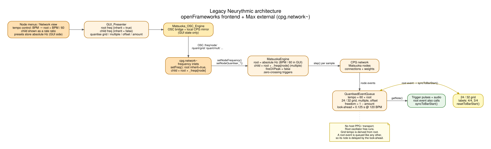
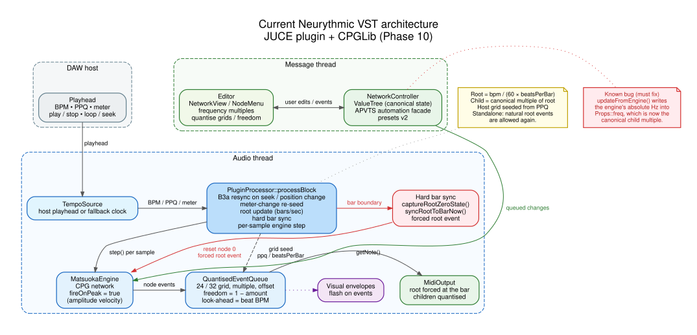
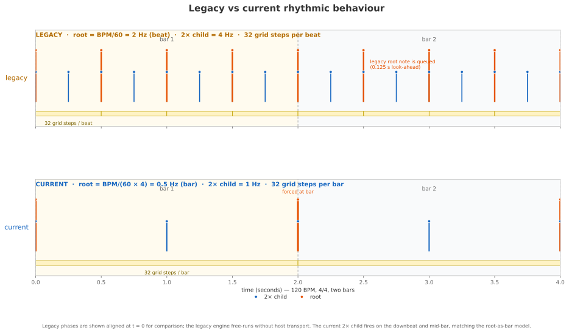
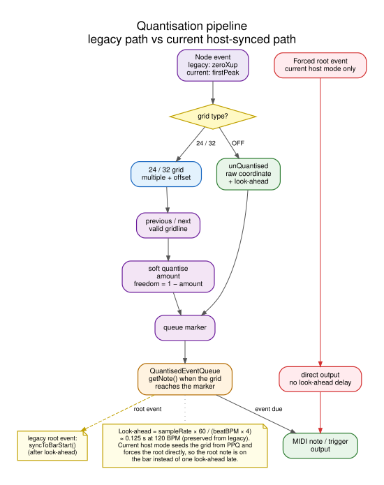
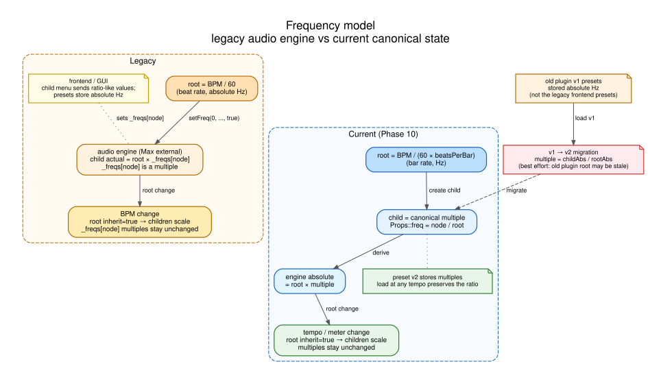
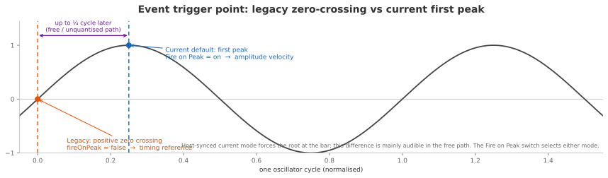

# Legacy vs current: architecture and behaviour

Visual companion to the Phase 10 legacy-adherence audit. It compares the original
Neurythmic architecture (openFrameworks frontend + Max external) with the current
JUCE plugin + CPGLib implementation.

> **Colour key**
> orange = legacy 
> · blue = current 
> · yellow = shared quantiser/grid 
> · red = host-sync path or a known issue.

> **Source caveat**
> The legacy code is internally inconsistent: the BPM control sets the root to
> `BPM/60` (a beat rate), while the quantiser labels and `BarDivision` describe
> 32 steps per 4/4 bar and 24 per 3/4 bar. The diagrams show the behaviour of the
> code as written, and the timeline calls out the consequence of that mismatch.

## 1. Legacy architecture



[PNG version](diagrams/legacy_architecture.png)

- The frontend is a GUI + OSC bridge (`Matsuoka_OSC_Engine`); the audio engine is
  the Max external `cpg.network~`.
- The BPM slider sends `bpm / 60` to the root with `inherit = true`, so the root
  is the **beat**.
- The Max external's `setFreq()` treats node 0 as the root (absolute Hz) and
  nodes > 0 as **multiples of the root** (`_freqs[node]`); the actual child is
  `root × _freqs[node]`. The legacy **audio engine** therefore already used a
  root-relative multiple for children.
- `updateQuantiserTempo()` sets the grid to `60 × root`. With a beat-rate root
  this is BPM, so the nominal 24/32 grid advances per **beat**, not per bar.
- A root event is queued like any other event and therefore inherits the
  quantiser look-ahead (~0.125 s at 120 BPM). When it is dequeued,
  `getNote()` calls `syncToBarStart()`.
- The frontend/child menu mixes ratio-like values with absolute display values,
  and its presets store **absolute Hz**; that GUI-side layer is where the
  inconsistency lives, not in the audio engine's child model.

## 2. Current architecture



[PNG version](diagrams/current_architecture.png)

- The host playhead supplies BPM, PPQ, meter and transport state. The processor
  owns resync-on-seek, meter-change re-seeding, root updates, hard bar sync and
  per-sample engine stepping.
- The root is the **bar**: `root = bpm / (60 × beatsPerBar)`.
- Root `Props::freq` stores the canonical **standalone** root; the effective
  host rate is published through `_displayRootFreq` and never written back.
- A child stores a **canonical multiple** in `Props::freq`; the engine receives
  `root × multiple`. Tempo changes scale the root with `inherit = true`, so the
  multiples stay valid.
- Host mode seeds the grid from `ppq / beatsPerBar` and forces the root event at
  the bar. In standalone/no-PPQ mode, natural root events are allowed again and
  the legacy root-driven `syncToBarStart()` path remains.
- The message thread owns the ValueTree/APVTS/editor and pushes queued actions
  to the audio thread.
- **Phase 11 fix:** `updateFromEngine()` no longer writes engine Hz back into
  the tree. Root `Props::freq` is the canonical standalone root; the effective
  host rate is published through `_displayRootFreq`. New children receive the
  same quantiser defaults in the tree and the engine, and the default
  quantiser multiple is 8.

## 3. Behaviour at a glance



[PNG version](diagrams/behaviour_timeline.png)

At 120 BPM in 4/4 over two bars:

| | Legacy | Current |
|---|---|---|
| Root rate | `BPM/60` = **2 Hz** (beat) | `BPM/(60×4)` = **0.5 Hz** (bar) |
| Root events | every 0.5 s | every 2 s, at the bar |
| 2× child | `root × 2` = **4 Hz** | `root × 2` = **1 Hz** |
| Grid | 32 steps per **beat** (because tempo = BPM) | 32 steps per **bar** |
| Root note timing | queued; delayed by the ~0.125 s look-ahead | forced directly at the bar; no look-ahead |
| Bar sync | `syncToBarStart()` on the root event | host PPQ seeding + forced root at the bar |
| Meter changes | manual per-node grid choice | host meter mapped to 24/32; grid re-seeded |

The practical result is the intended user-facing behaviour: the root is the
downbeat, and a 2× child fires **together with the root at the downbeat, then
alone mid-bar, then together again**.

## 4. Quantisation pipeline



[PNG version](diagrams/quantisation_pipeline.png)

- The grid maths are shared: `unQuantised` bypasses snapping; the 24/32 grids
  use multiple + offset; `previous/next valid gridline` + `soft quantise amount`
  produce the queue marker; `freedom = 1 − amount`.
- The look-ahead is derived from the **beat** tempo:
  `sampleRate × 60 / (beatBPM × 4)` ≈ 0.125 s at 120 BPM. This matches the
  legacy empirical behaviour and is deliberately decoupled from the grid tempo.
- The legacy root event goes through the queue and calls `syncToBarStart()` when
  dequeued.
- The current host-synced root event bypasses the queue and is emitted directly,
  so it lands on the bar instead of one look-ahead late.

## 5. Frequency model and presets



[PNG version](diagrams/frequency_model.png)

- **Legacy audio engine:** the root is the beat rate (absolute Hz); a child is
  `root × _freqs[node]`, where `_freqs[node]` is a **multiple**. A BPM edit uses
  `inherit = true`, so the children scale and the multiples stay unchanged.
- **Legacy frontend:** the child menu and presets mix ratio-like values with
  absolute display values; presets store absolute Hz. That GUI-side layer is
  where tempo drift could enter.
- **Current:** a child stores `node/root` as a canonical multiple. The engine
  derives absolute frequency as `root × multiple`. This **matches the legacy
  audio engine's child semantics** and makes presets tempo-independent.
- **v1 → v2 migration:** `multiple = childAbs / rootAbs`. This is for the old
  **plugin** v1 presets (absolute Hz), not the legacy frontend presets. It is
  best effort: the old plugin's root may be stale, so re-saving after load is the
  reliable way to lock in the migrated ratios.

## 6. Event trigger point



[PNG version](diagrams/event_trigger_timing.png)

This is the main engine-use difference in the **free/unquantised** path:

- Legacy Max external: `fireOnPeak = false` → trigger at the positive zero
  crossing, with a fixed trigger amplitude.
- Current plugin: a **Fire on Peak** switch in the main menu selects between
  first-peak triggering (on; peak amplitude as MIDI velocity) and legacy
  positive-zero-crossing triggering (off; fixed velocity).
- In host-synced mode the root is forced at the bar, so this difference is
  mostly audible when quantisation is off or the freedom amount is high.

## 7. Adherence summary

| Area | Verdict |
|---|---|
| CPGLib oscillator/CPG maths, config, calibration, per-sample stepping | Faithful |
| Quantiser grids, multiples, offsets, amount/freedom, soft quantise | Faithful |
| Look-ahead (~0.125 s at 120 BPM) | Preserved |
| Root frequency inheritance (`inherit = true` for root) | Faithful |
| Root units (beat → bar) | Deliberate Phase 10 change; matches the bar-oriented grid labels |
| Host PPQ seeding + hard bar sync | Deliberate host integration; standalone keeps root sync |
| Child frequency model (root-relative multiple) | Faithful to the legacy Max external (`_freqs[node]`); v2 presets store the engine-native multiple |
| Legacy frontend absolute presets | Different; v2 multiples are tempo-independent |
| Event trigger point | Selectable in the menu: first peak (default) or legacy positive zero crossing |
| Default `gridFollowHost = true` | Host-first; the free path is available by opting out |
| Default `quantMultiple = 8` | Aligned with the legacy spawn value and the engine child-slot default |
| `updateFromEngine()` frequency writeback | Fixed in Phase 11; no engine Hz is written into canonical state |
| Preset state | Network + APVTS are saved together; root/master/trigger survive a round-trip |
| Sample-rate calibration | Recalibrates when `prepareToPlay()` changes the host rate |

## 8. Diagram sources

The editable sources live in `docs/diagrams/src/`:

- `legacy_architecture.dot`
- `current_architecture.dot`
- `quantisation_pipeline.dot`
- `frequency_model.dot`
- `behaviour_timeline.py`

Regenerate the Graphviz diagrams from the repository root:

```bash
cd docs/diagrams
for f in src/*.dot; do
  n=$(basename "$f" .dot)
  dot -Tsvg "$f" -o "$n.svg"
  dot -Tpng -Gdpi=160 "$f" -o "$n.png"
done
python3 src/behaviour_timeline.py
```
